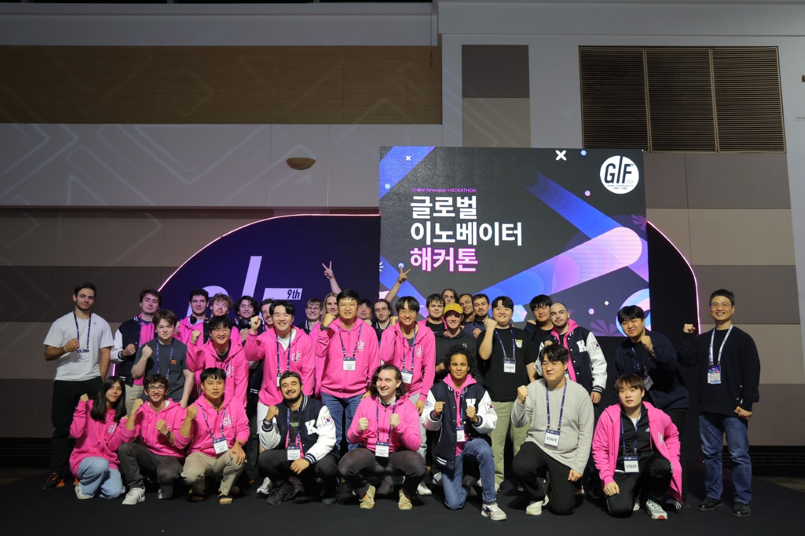
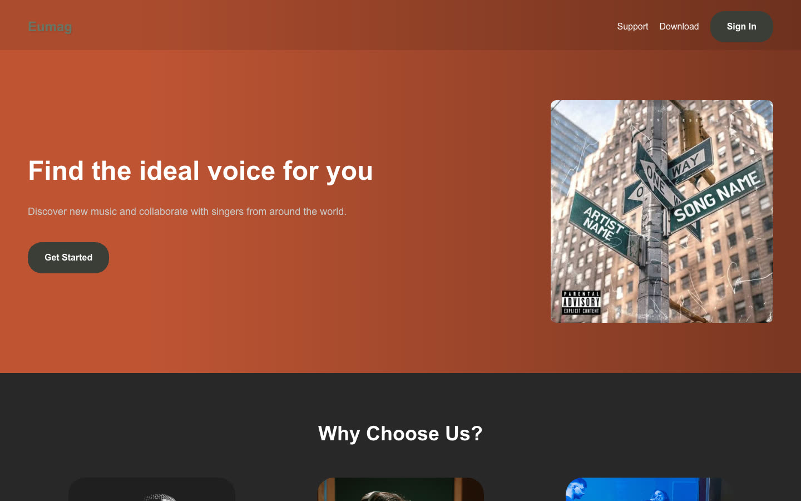
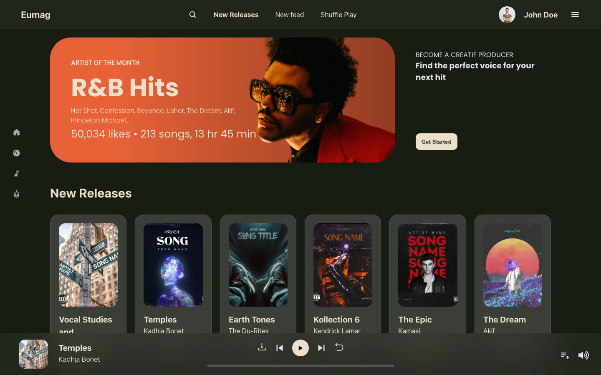
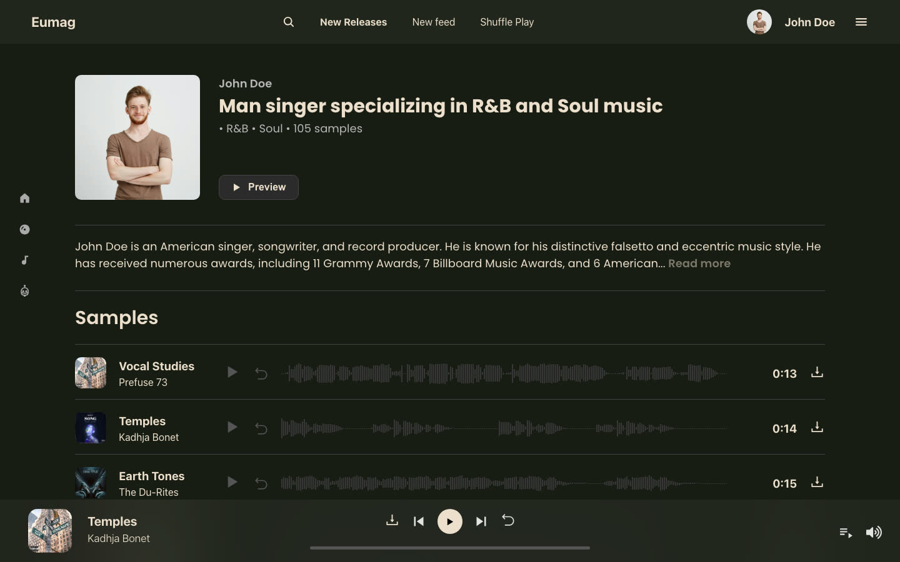
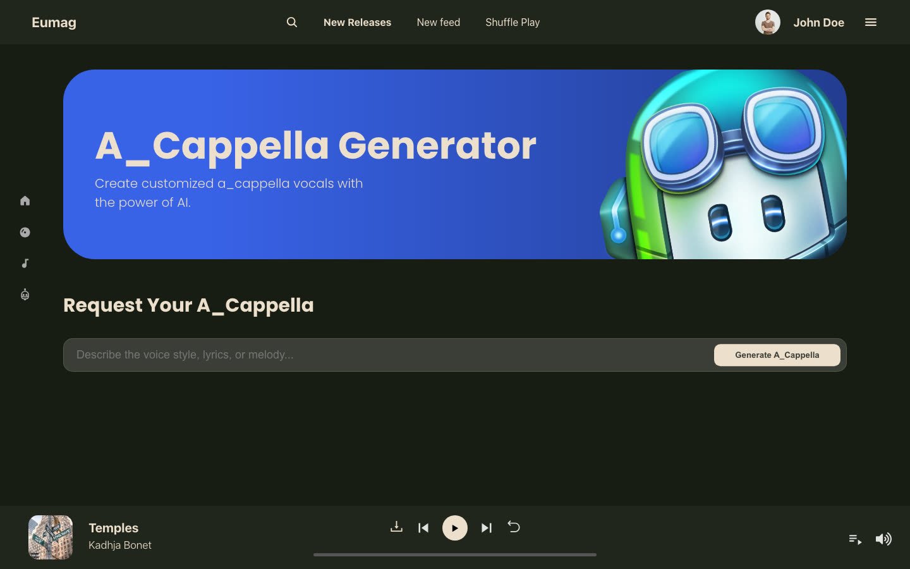
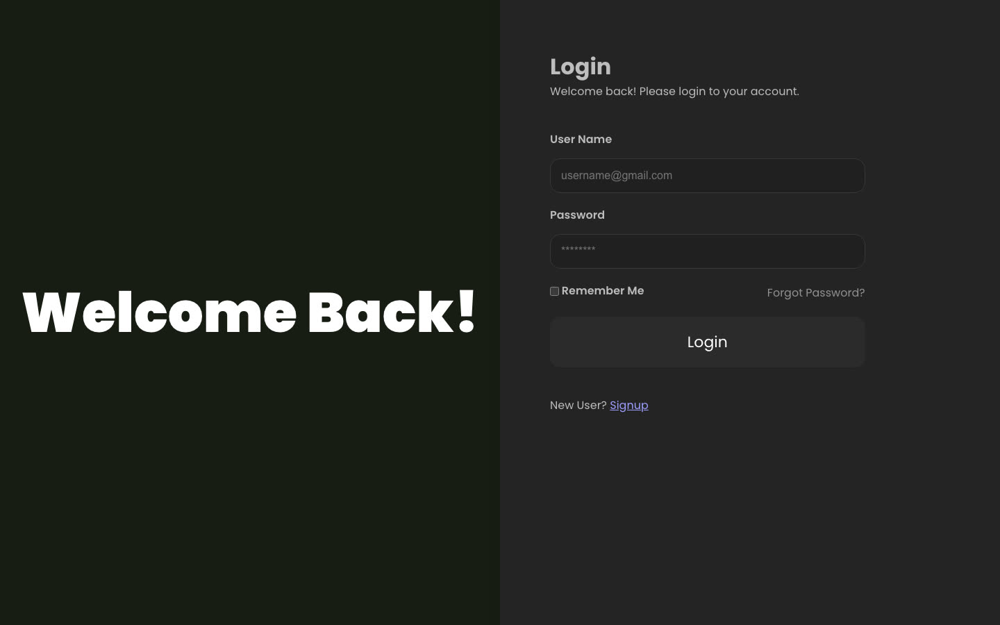

# Eumag — GIF 2024 Global Innovator Hackathon

Eumag is a music platform where composers and producers find the right voice for their next track: browse singers, listen to their a cappella samples, and ask an AI to generate a custom a cappella from a short description.

It was built in two days (24–25 October 2024) by a team of Keimyung University students for the **Global Innovator Hackathon** at **GIF 2024**, the 9th [Global Innovator Festa](https://www.gifesta.kr/) in Daegu, South Korea. It was one of the award-winning projects.

> **Status:** archived. This is a hackathon prototype, kept as a record of the event. The dependencies were updated in November 2026 so that it still installs and builds cleanly, but nothing else is planned.



<sub>Participants of the GIF 2024 Global Innovator Hackathon, Daegu. Photo: [GIF 2024 gallery](https://www.gifesta.kr/page/gallery2024).</sub>

## The event

GIF (글로벌이노베이터페스타, Global Innovator Festa) is an innovation and startup festival hosted by Daegu Metropolitan City and organised by the Daegu Center for Creative Economy & Innovation, with the support of the Ministry of SMEs and Startups. The 2024 edition included the Global Innovator Hackathon (글로벌 이노베이터 해커톤), where university students had two days to design and build a product from scratch.

## The project

| Page                 | Route       | What it shows                                                                                         |
| -------------------- | ----------- | ----------------------------------------------------------------------------------------------------- |
| Landing              | `/landing`  | Product pitch: find the ideal voice, high-quality samples, a collaborative space                      |
| Login                | `/login`    | Sign-in form (no back end: any input leads to the home page)                                          |
| Home                 | `/`         | Artist of the month, new releases carousel, persistent player                                         |
| Singer profile       | `/profile`  | Singer bio and a list of a cappella samples with waveforms, playback and download                      |
| A cappella generator | `/generate` | Describe a voice style, lyrics or melody, get an a cappella back (AI generation simulated for the demo) |

It is a front-end prototype: there is no server, accounts and generation are mocked, and the covers and samples are placeholder content used for the demo.

## Screenshots

<table>
<tr><td align="center"><br><sub>Landing page</sub></td><td align="center"><br><sub>Home</sub></td></tr>
<tr><td align="center"><br><sub>Singer profile with samples</sub></td><td align="center"><br><sub>A cappella generator</sub></td></tr>
<tr><td align="center"><br><sub>Login</sub></td><td></td></tr>
</table>

## Tech stack

React 18, TypeScript, Vite 7, React Router 7, wavesurfer.js (waveforms), Howler (audio playback), react-icons.

## Getting started

Requires Node.js 20.19+ or 22.12+.

```sh
npm ci
npm run dev       # development server on http://localhost:5173
npm run build     # type-check and production build in dist/
npm run preview   # serve the production build
npm run lint
```

Open `/landing` for the product page, or `/` for the app itself.

## Team

- Louis Lejaille ([@LLEJAILLE](https://github.com/LLEJAILLE))
- Antoine ([@AntoineZK](https://github.com/AntoineZK))
- Alexandre DE FREITAS MARTINS ([@AlexandreDFM](https://github.com/AlexandreDFM))

The original repository is [LLEJAILLE/hackathonDaegu](https://github.com/LLEJAILLE/hackathonDaegu).
